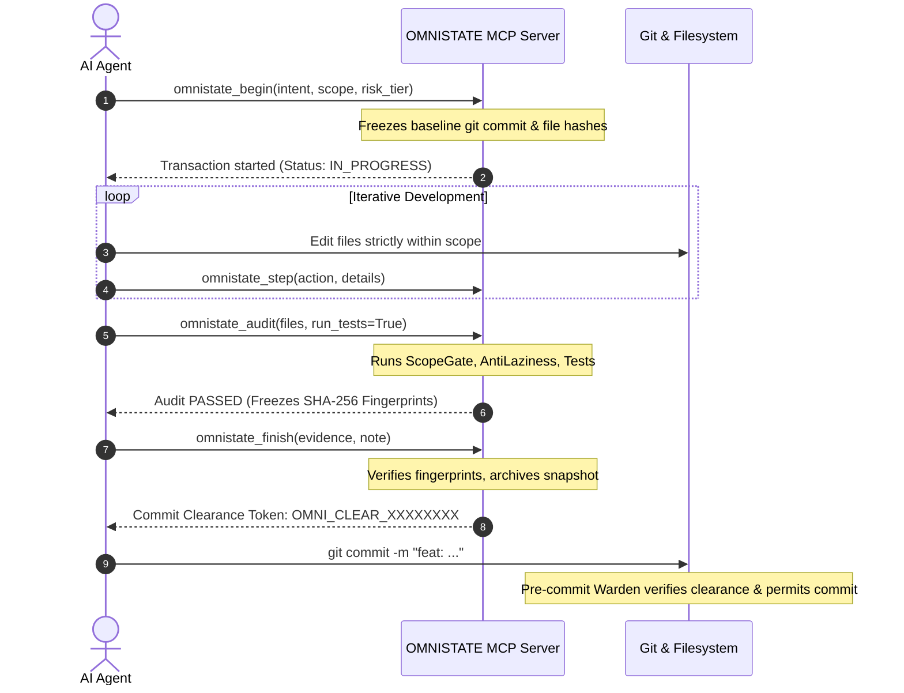

# 🌐 OMNISTATE Universal State Governance & Guardrails Skill

This skill governs the execution of all software modifications under the **OMNISTATE** state governance framework. It ensures zero context loss across AI sessions, enforces strict scope boundaries, rejects lazy code omissions, and guarantees verified commits.

---

## 1. Core System Invariants (剛性天條)

1. **Transaction Mandatory (交易優先)**:
   - Never write or edit code without an active transaction session.
   - Always call `begin` before modifying files, and `finish` after passing `audit`.
2. **Scope Enclosure (範疇不越界)**:
   - Only modify files declared in `scope_paths`.
   - Modifying files outside scope causes `ScopeEnclosureGate` to fail immediately.
3. **Zero-Laziness Diff (零偷懶代碼)**:
- **STRICTLY FORBIDDEN**: Inserting ellipsis placeholders (`// ...`, `# ... existing code ...`, `<!-- ... -->`, `// rest of code unchanged`, `# TODO: implement`).
   - Every file modification must be complete, syntactically valid, and maintain docstring and comment integrity.
4. **Anti-Tamper Cryptographic Lock (防竄改指紋鎖)**:
   - When `audit` passes, SHA-256 fingerprints of all modified files are frozen.
   - Any sneaky edits made after audit without re-auditing will cause `finish` and `warden` to BLOCK.
5. **Git Warden Clearance (憑證放行)**:
   - Git commits are blocked by `.git/hooks/pre-commit` unless an active session was finished with a valid `OMNI_CLEAR_XXXXXXXX` token.

---

## 2. Standard Workflow: MCP Tool Mode (AI 推薦)

If your environment is connected via Model Context Protocol (MCP), use the dedicated tool calls:



### Key MCP Tools
* `omnistate_begin(intent="...", scope=["src/", "tests/"])`: Opens transaction.
* `omnistate_step(action="...", details="...")`: Records incremental milestone.
* `omnistate_audit()`: Deterministically verifies all gates.
* `omnistate_finish(evidence=["tests/report.txt"])`: Seals transaction and receives clearance.
* `omnistate_abort(rollback=False)`: Cancels transaction if blocked or user requests abort.
* `omnistate_status()`: Checks current state and clearance.

---

## 3. Standard Workflow: Terminal CLI Mode (命令行模式)

When operating via bash or powershell:

### Step 1: Open Transaction
```bash
omnistate begin --intent "Implement user profile API" --scope "src/api/,tests/" --risk standard
```

### Step 2: Record Progress
```bash
omnistate step --action "Created user profile schema and route"
```

### Step 3: Run Deterministic Audit
```bash
omnistate audit
```
*If audit fails due to scope violations or ellipsis placeholders, fix the code and re-run `omnistate audit`.*

### Step 4: Finalize & Acquire Clearance Token
```bash
omnistate finish --evidence "tests/report.txt" --note "All tests passed"
```

### Step 5: Safe Git Commit
```bash
git commit -m "feat(api): implement user profile endpoint"
```

---

## 4. The 3 Critic Self-Inspection Questions (三大靈魂質問)

Before calling `audit` or `finish`, the agent must internally verify:

1. **Q1: 有沒有偷懶？ (Anti-Laziness)**
   - Did I leave any `// ...`, `# TODO`, or cut corners?
   - Did I preserve all existing comments, docstrings, and error handling?
2. **Q2: 有沒有更完善的方法？ (Better Solution & Anti-Bloat)**
   - Did I introduce unnecessary duplicate code or boilerplate?
   - Is the implementation concise, modular, and adhering to single-responsibility?
3. **Q3: 有沒有越界改動？ (Scope Boundary)**
   - Did I touch any file not declared in `scope_paths`?
   - Is every changed line justified by the original intent?


## Exit Criteria (Evidence-Bound Definition of Done)

OMNISTATE 狀態治理任務僅在下列條件全部滿足時標記為完成：
1. **PlanningGate 通過**：包含 Memo 原始 Prompt 記錄、Checklist 全數通過、相依 Subtasks 圖譜無未竟任務。
2. **獨立審查核可**：omnistate plan-review 狀態為 APPROVED 或 RESOLVED。
3. **Audit 硬閘全綠**：ScopeGate、AntiLazinessCritic、AntiBloatCritic 均通過。
4. **Warden 核發 Clearance Token**：成功完成 omnistate finish 並產出不可竄改指紋。

> [!CAUTION]
> **失敗出口 (Hold / Blocked)**：  
> 出現未關聯 Subtask、未解決審查衝突、Diff 殘留佔位符或測試未通過時，狀態保持為 hold 或 locked。