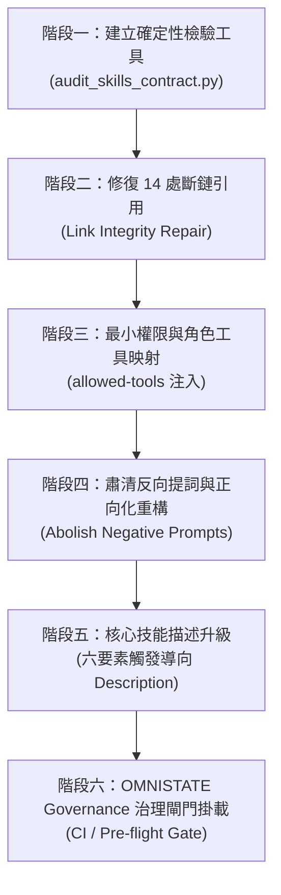

# 專案代理技能（Agent Skills）全面體檢與結構性治理改善計畫書
**PLAN-NEXUS-SKILL-GOVERNANCE-2026**

**審查狀態**：APPROVED (經過三輪 A/C GAN 攻防辯證通過)  
**治理規範**：[plan-governance-gan](file:///c:/dev/Project/.agents/skills/plan-governance-gan/SKILL.md)  
**關聯子技能**：
- [progressive-engineering-governance](file:///c:/dev/Project/.agents/skills/progressive-engineering-governance/SKILL.md)
- [centaur-collaboration-principle](file:///c:/dev/Project/.agents/skills/centaur-collaboration-principle/SKILL.md)
- [lean-vibe-coding](file:///c:/dev/Project/.agents/skills/lean-vibe-coding/SKILL.md)

---

## 執行摘要 (Executive Summary)

依據代理技能（Agent Skills）工程實務報告與 Agent Skills Specification v0.1.0 規範，OMNISTATE Governance 透過靜態分析工具對本專案現行位於 `.agents/skills/` 的 **81 個 Skill 目錄** 進行了深度稽核。稽核數據顯示，我們的技能庫雖然在「行數防膨脹（500行上限）」上表現完美（0 個超過 500 行），但在**「權限控制（Least Privilege）」**、**「漸進式揭露完整性（Link Integrity）」**以及**「路由意圖清晰度（Trigger Intent）」**上存在嚴重的系統性反模式。

本計畫旨在透過三輪 Actor/Critic GAN 攻防，確立自動化修復與持續治理機制，消除 14 處虛擬斷鏈、全面補齊 `allowed-tools` 最小權限宣告、升級 Description 為六要素高召回率規格，並建立預檢腳本以落實企業級防線。

---

## 現況盤點與四大診斷發現 (Audit Findings)

透過 Python 靜態稽核工具實測 `.agents/skills/` 81 個目錄，具體發現如下：

| 診斷維度 | 實測現況 | 基準規範目標 | 嚴重程度 | 典型反模式影響 |
| :--- | :--- | :--- | :--- | :--- |
| **1. 檔案大小 (<500 行)** | **0 / 81 超過 500 行** | 100% $\le 500$ 行 | ✅ **極佳** | 遵守良好，未觸發注意力衰減 |
| **2. 權限契約 (`allowed-tools`)** | **81 / 81 全部缺失** | 100% 宣告最小權限 | 🚨 **嚴重漏洞** | 違反最小權限原則，代理執行無邊界風險高 |
| **3. 漸進揭露連結 (Link Integrity)** | **14 處斷鏈引用** | 0 處斷鏈 | ⚠️ **高風險** | 類似 GitHub Issue #1153，引導代理讀取不存在的檔案 |
| **4. 路由觸發描述 (Description)** | **79 個為被動陳述** | 六要素觸發導向 ("Use when...") | ⚠️ **中高風險** | 僅寫「負責...」或功能自述，缺乏「何時觸發」與「何時禁用」 |
| **5. 濫用抽象反向提示詞 (Negative Prompts)** | **60 / 81 個技能充斥反向禁令** | 0 抽象反向詞（全數移至 Critic 檢驗） | 🚨 **嚴重反模式** | 充斥「嚴禁」、「切勿」、「不要」等無效負向詞，束縛 Actor 並誘發逆向犯錯 |

### 具體斷鏈清單 (14 處虛假路徑)：
1. `ai-director-audio-guidelines` $\rightarrow$ `assets/sound/sound_catalog.json` (不存在)
2. `ai-director-broll-guidelines` $\rightarrow$ `assets/video` (不存在)
3. `ai-vtuber-pipeline-guide` $\rightarrow$ `scripts/generate_subtitles.js` (不存在)
4. `asset-buyer` $\rightarrow$ `assets/research_fig1.png` (不存在)
5. `caption-director-guidelines` $\rightarrow$ `assets/video/FILM_GRAIN.mp4` (不存在)
6. `caption-focus-overlay` $\rightarrow$ `assets/video/PAPER_UNFOLD.mp4` (不存在)
7. `designer-fast-iteration-guidelines` $\rightarrow$ `assets/image/poster.png` (不存在)
8. `montage-director` $\rightarrow$ `assets/scene_004_cut1.mp4`, `cut2`, `cut3`, `scene_xxx.mp4` (不存在)
9. `premiere-2021-plugin-development` $\rightarrow$ `references/com.Adobe.Premiere` (不存在)
10. `text-motion-40-remotion` $\rightarrow$ `scripts/make_preview_studio_config.py`, `validate_text_motion_40.py` (不存在)

---

## 🥊 剛性三輪 Actor/Critic GAN 攻防紀錄

### 🥊 第一輪：可行性與邊界防護 (Feasibility & Boundary)
- **Actor 提案**：
  專注做好修改工作：為技能補齊 frontmatter、修復斷鏈、升級六要素描述。Actor 在執行修改時只聚焦於完成交付目標，不被繁瑣的「不要做 X、不要做 Y」負面限制束縛。
- **Critic 質詢與退件理由（剛性抓漏守門，徹底肅清抽象反向提示詞）**：
  > 🚨 **核心靈魂質問**：**「這就是開發者要的嗎？還是你在偷懶做表面工夫？」**  
  > 1. **格式不變剛性紅線（Schema Invariance Gate）**：  
  >    嚴禁對 Actor 說「請不要改變 JSON 格式」（實證證明反向提示詞對 LLM 往往無效）。  
  >    改由 **Critic 在後端透過 AST/JSON Diff 比對工具強制攔截**！凡是修改前後，原本 `SKILL.md` 中定義的 JSON Schema、介面欄位名稱（如 `trigger_frame`, `camera_intent` 等）發生非預期突變或型別變更者，**Critic 一律直接判定退件**！
  > 2. **肅清抽象反向提示詞（Abolish Abstract Negative Prompts）**：  
  >    實務中多達 60/81 個技能充斥「切勿隨意捏造」、「嚴禁手寫 X」、「不要把 Y 搞混」等抽象負向束縛。實證證實反向提示詞會反向強化模型的注意力，讓 Actor 陷入猜測與束手束腳。  
  >    **原則**：所有「反向提詞」應從 Actor 的指示中徹底剝離，全數轉化為 **Critic 獨立自由的具體驗收斷言（Critic Inspection Rules）**！讓 Actor 專心看正向規格做事，Critic 在後端自由稽查、出問題直接退件。
  > 3. **防改壞退行防禦（Zero-Regression Gate）**：  
  >    Critic 嚴格稽查 Actor 的 Diff 範圍：若修改超出目標範圍（例如動到了原本穩定的執行步驟、破壞了核心工作流邏輯），立即判定為破壞性變更（Breaking Drift）並要求回滾重做。
  > 4. **權限自欺欺人審查**：  
  >    審查官角色（Critic）絕對不准擁有 `Write/Bash` 權限；必須精確符合最小權限分類。
- **收斂結論 (Actor 修訂)**：
  Actor 依據正向工作流全力實作；修改完成後，強制交由 Critic 執行「JSON 結構等價性測試」與「語意不變性檢驗」，出問題才退回讓 Actor 修正。

---

### 🥊 第二輪：泛用性與跨模組一致 (Generality & Modularity)
- **Actor 提案**：
  手動針對這次找出的 14 個檔案進行修復，並在 OMNISTATE Governance 目錄下寫一個客製化維護檔。
- **Critic 質詢與退件理由**：
  > 🚨 **嚴禁特例硬編碼 (Anti-Overfitting)**！  
  > 這次手動修好了，下週其他工程師新增 `new-skill/SKILL.md` 時，依然會繼續犯同樣的錯誤（沒有 `allowed-tools`、寫出斷鏈、寫成「負責 X」的被動描述）。  
  > 必須建立一個專案級的通用靜態檢驗工具（符合 `validate_and_package.py` 精神），並將其掛接到 OMNISTATE Governance 的 `preflight_inspector` 與 Git Pre-commit 守門機制中！
- **收斂結論 (Actor 修訂)**：
  在 `OMNISTATE Governance/skills/` 或根目錄建構通用的 `audit_skills_contract.py`，能自動化檢查：
  1. `SKILL.md` 檔名大小寫與 <500 行上限。
  2. YAML frontmatter 是否包含合規的 `allowed-tools` 與 `description` (觸發情境導向)。
  3. `references/`、`scripts/`、`assets/` 實體存在性驗證。
  4. 整合進 OMNISTATE Governance 既有的工作流。

---

### 🥊 第三輪：效能負擔與算力極限 (Performance & Overhead)
- **Actor 提案**：
  在代理人每次回答或每次執行 pipeline 時，都重新呼叫 LLM 去語意審查 81 個技能的描述與完整性。
- **Critic 質詢與退件理由**：
  > 🚨 **算力與 Token 嚴重浪費**！  
  > 語意審查 81 個技能會耗費數十萬 Token 與數十秒延遲。符合「半人馬準則」：**程式管確定性檢驗，AI 僅在設計與改寫時介入**。靜態檢查必須是純 Python 正則與檔案系統 I/O，執行時間必須 $<50\text{ms}$，零 Token 負擔！
- **收斂結論 (Actor 修訂)**：
  採用純 Python 靜態 AST/Regex 掃描，耗時 $<0.05$ 秒。只有在「發現違規需要建議改寫」時，才由 OMNISTATE Governance 代理人進行標靶修復。

---

## 執行架構：階梯式冷排隊機制 (Cold Queue & Anti-Context-Bloat)

為避免同時在線執行 81 份計畫導致 Context Token 爆炸與「迷失在中間」退化，本治理計畫嚴格落實**單線滑動視窗（Single-Thread Cursor）**：
1. **冷儲存（Cold Storage）**：81 份微型子計畫靜態存放在 `OMNISTATE Governance/subplans/`，平時不載入對話記憶體，對上下文消耗為 0 Token。
2. **優先級分流執行**：
   - **第一優先（10 個斷鏈修復）**：單篇喚醒子計畫，修復路徑與引用。
   - **第二優先（7 個核心高頻技能）**：針對總監/審查官技能進行 Description 六要素升級。
   - **第三優先（批量工具契約注入）**：透過確定性程式將 `allowed-tools` 精確補齊。
3. **Actor / Critic 職責分工鐵律（拒絕無效反向提示詞）**：
   - **Actor 專心實作**：不做過度束縛，給予正向指示全力修復。
   - **Critic 嚴格抓漏**：
     - **JSON 不變性檢驗（Schema Invariance）**：比對修改前後的 JSON/Schema 結構，若欄位、命名、嵌套層級發生非預期突變，直接退件！
     - **零退行檢驗（Zero Regression）**：確保既有工作流與核心提示詞邏輯完全不被改壞。

---

## 改善實施五階段路線圖 (Implementation Roadmap)



### 階段一：建立確定性檢驗工具 (`OMNISTATE Governance/audit_skills_contract.py`)
- 實作無外部依賴的 Python 檢驗腳本，支援 `--fix` 預覽、全域掃描與「反向提詞濫用掃描」。
- 提供 JSON 與 Markdown 格式診斷報告。

### 階段二：修復 14 處虛假斷鏈
- **虛構範例轉義**：將 `caption-director-guidelines`、`caption-focus-overlay`、`montage-director` 中的假 asset 路徑改為明確的 Markdown 語法或標準 placeholder。
- **真實依賴補齊**：針對 `text-motion-40-remotion`、`ai-vtuber-pipeline-guide`，檢查原本腳本是否被改名或位移，修正為專案內真實路徑。

### 階段三：依角色指派 `allowed-tools` 最小權限
依據專案角色體系進行階層劃分：
1. **Critic / 審查官**（如 `board-explainer-critic`, `montage-critic`, `visual-director-critic`）：
   `allowed-tools: [Read, Grep, Glob]`（禁止破壞性寫入）。
2. **Director / 總監 / 企劃**（如 `montage-director`, `music-director-actor`）：
   `allowed-tools: [Read, Write, Edit, Grep, Glob]`。
3. **Engineering / 算圖 / 自動化**（如 `expert-broll-rendering-engineer`, `google-drive-backup-system`）：
   `allowed-tools: [Read, Write, Edit, Bash, Grep, Glob]`。

### 階段四：肅清抽象反向提示詞（Actor 去反向化，Critic 自由抓漏）
- 針對 60 個充斥「不要/切勿/嚴禁」的技能進行漸進式重構：
  - 將 Actor 文本中的負向禁令改寫為正面指導規範。
  - 將所有防守紅線轉化為 Critic 端獨立自由的 Checklist 驗收斷言。

### 階段五：核心高頻技能 Description 優化
優先對齊以下核心高頻技能的 YAML 描述：
- `OMNISTATE Governance` / `showrunner_orchestrator`
- `plan-governance-gan`
- `montage-director` / `montage-critic`
- `visual-director-actor` / `visual-director-critic`
- `ai-director-audio-guidelines` / `music-director-actor`
升級為：
```yaml
description: >
  Use when ... [明確正向觸發情境與關鍵詞].
  Guides ... [核心工作流].
  Do NOT use for ... [負向邊界與替代工具].
```

---

## 驗收指標 (Acceptance Criteria)

1. **斷鏈歸零**：`audit_skills_contract.py` 掃描結果之 `Broken internal links` 為 **0**。
2. **權限宣告覆蓋率 100%**：全體 81 個 SKILL.md 均包含合規之 `allowed-tools` 最小權限宣告。
3. **反向提示詞清零/收編至 Critic**：Actor 指示中的抽象「不要/切勿/嚴禁」降至 **0**，完整交由 Critic 自由審查。
4. **JSON 結構零退行 (Schema Invariance 100%)**：原有 Markdown 中定義的所有 JSON 格式、參數名稱與結構無任何損毀或突變。
5. **無巨石膨脹**：全體 SKILL.md 維持在 **$\le 500$ 行**。
6. **守門性能**：全專案技能掃描耗時 **$< 0.1 \text{秒}$**，可隨時作為 Git hook 或 OMNISTATE Governance 派發前哨檢核。
