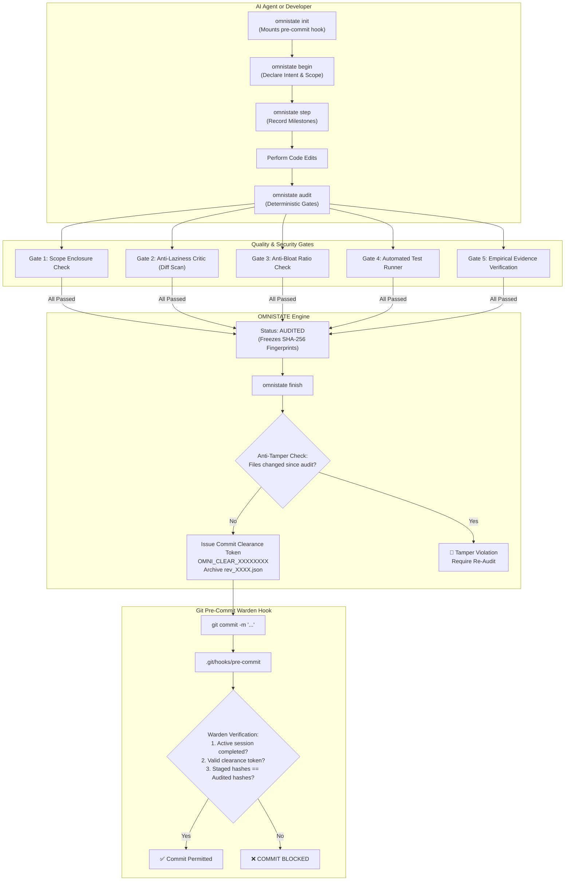

# 🌐 OMNISTATE

## Planning before implementation

Prompted transactions must record the original requirement in a memo, decompose it into checklist items and dependency-aware subtasks, and attach evidence before `audit`/`finish`. Use `memo`, `checklist`, and `subtask` after `begin`; the planning gate rejects unfinished or unlinked work.

> **Universal State Governance, Transaction Guardrails & Anti-Bypass Framework for AI Agents, MCP & CLI**  
> *Zero Context Loss • Scope Enclosure • Anti-Laziness Diff Defense • Git Pre-commit Warden*

[](https://opensource.org/licenses/MIT)
[](https://www.python.org/)
[](https://modelcontextprotocol.io/)
[]()

---

## 🎯 The Problem

When Large Language Models (LLMs) and autonomous AI coding agents (Claude, Cursor, Copilot, ChatGPT, Cline, Antigravity) develop software, they inevitably run into four critical failure modes:

1. **Context Loss & Amnesia Across Sessions**: When a chat restarts or compacts, the AI forgets what was changed, what decisions were made, or what step it was on.
2. **Scope Creep & Accidental Regression**: The AI modifies files far outside its intended scope, breaking unrelated features or deleting essential comments and functions.
3. **Lazy AI Placeholders**: The AI generates truncated code snippets such as `// ... rest of implementation unchanged`, `# TODO: implement this`, or silently deletes production logic.
4. **Unverified Commits**: The AI hallucinates that "all tests pass" and commits directly to git without empirical proof or verified evidence.

**OMNISTATE solves this by bringing deterministic ACID transaction semantics, multi-gate automated auditing, and a tamper-proof Git Warden to any software project.**

---

## 🏗️ Architecture & Transaction Lifecycle



---

## ✨ Key Features

- **🛡️ ACID Transactions for AI Edits**: `begin` $\rightarrow$ `step` $\rightarrow$ `audit` $\rightarrow$ `finish` $\rightarrow$ `commit`.
- **🔌 Dual-Mode Adapters**:
  - **CLI Mode**: Full-featured terminal interface with rich dashboards.
  - **MCP Server Mode (Model Context Protocol)**: Exposes state tools directly to Claude Desktop, Cursor, Antigravity, OpenCode, Windsurf, and any MCP client over stdio.
- **🔒 Anti-Tamper & Anti-Laziness Guardrail**:
  - Scans unified diffs for lazy ellipsis comments (`// ...`, `# TODO: implement`).
  - Cryptographically locks audited files via SHA-256. Any modification made *after* audit invalidates the clearance token.
- **👮 Git Warden Pre-Commit Hook**:
  - Blocks any `git commit` or `git push` if code was not properly audited and cleared by OMNISTATE.
- **📦 Zero External Dependencies**:
  - Pure Python standard library (compatible with Python 3.8+). No heavy dependencies, no version conflicts.
- **📜 Immutable History Snapshots**:
  - Automatically records full state history in `.omnistate/snapshots/rev_0001.json` with revision deltas.

---

## 🚀 Quick Start

### 1. Installation

```bash
git clone https://github.com/cwen0224/omnistate.git
cd omnistate
pip install -e .
```

Or install directly via pip (once published):
```bash
pip install omnistate
```

---

### 2. Initialize in Your Project

In any git repository:
```bash
cd /path/to/your/project
omnistate init
```
This will:
1. Create the `.omnistate/` directory with `omnistate.json` configuration.
2. Install the automated `pre-commit` hook in `.git/hooks/pre-commit`.

---

## 🤖 Using with AI via MCP (Model Context Protocol)

OMNISTATE includes a built-in, zero-dependency MCP server that enables AI models to govern their own changes safely.

### Claude Desktop Configuration
Add the following to your `claude_desktop_config.json`:

```json
{
  "mcpServers": {
    "omnistate": {
      "command": "omnistate-mcp",
      "args": ["--workspace", "/path/to/your/project"]
    }
  }
}
```

### Cursor / Windsurf / Antigravity / OpenCode Configuration
Add to your project's MCP settings:

```json
{
  "name": "omnistate",
  "command": "python",
  "args": ["-m", "omnistate.mcp", "--workspace", "."]
}
```

### Tools Exposed to the AI
| MCP Tool Name | Description |
|---|---|
| `omnistate_init` | Initialize state governance and pre-commit hook in workspace |
| `omnistate_begin` | Start a transactional state change with declared intent and scope boundaries |
| `omnistate_step` | Record an incremental milestone or progress step |
| `omnistate_audit` | Deterministically verify modified code against scope, anti-laziness, and test gates |
| `omnistate_finish` | Verify anti-tamper fingerprints, archive immutable snapshot, and issue commit clearance |
| `omnistate_abort` | Abort active transaction and optionally roll back uncommitted changes |
| `omnistate_status` | Return active transaction status, git state, and clearance token |
| `omnistate_inspect_diff` | Scan working tree diff for anti-laziness violations |
| `omnistate_explain_rules` | Return state governance and guardrail rules for the AI context |

---

## 💻 CLI Usage Guide

### 1. Begin a Task
```bash
omnistate begin --intent "Implement OAuth login" --scope "auth/,tests/" --risk standard
```

### 2. Record Progress
```bash
omnistate step --action "Implemented JWT token parser" --details "Added unit test in test_auth.py"
```

### 3. Check Governance Dashboard
```bash
omnistate status
```
Output:
```text
==================================================================
  🌐 OMNISTATE STATE GOVERNANCE DASHBOARD (v1.0.0)
==================================================================
  Project Root     : /home/dev/my-project
  State Directory  : /home/dev/my-project/.omnistate
  Current Revision : #0012
  Git HEAD Commit  : a4b91ef201
------------------------------------------------------------------
  Transaction ID   : sess_3f1a92b810de
  Transaction State: 🟡 [ IN_PROGRESS ]
  Intent Summary   : Implement OAuth login
  Scope Boundary   : ['auth/', 'tests/']
  Risk Tier        : STANDARD
  Steps Recorded   : 3
  Audit Status     : ⏳ PENDING (Run 'omnistate audit' when edits complete)
------------------------------------------------------------------
  Working Tree Mod : 2 files modified
    • auth/oauth.py
    • tests/test_oauth.py
==================================================================
```

### 4. Audit Modifications
```bash
omnistate audit
```
Output:
```text
================ OMNISTATE AUDIT RESULTS ================
  ✅ PASS | ScopeEnclosureGate
  ✅ PASS | AntiLazinessCritic
  ✅ PASS | AntiBloatCritic
  ✅ PASS | TestRunnerGate
=========================================================
🎉 All quality gates PASSED! Ready to execute 'omnistate finish'.
```

### 5. Finalize & Unlock Git Commit
```bash
omnistate finish --evidence "tests/report.txt" --note "All tests green"
```
Output:
```text
🎉 [OMNISTATE] Transaction COMPLETED: sess_3f1a92b810de
🛡️  Commit Clearance Token: OMNI_CLEAR_8A90F1BC24D7A19E
📦 Archived Revision     : #0013
🚀 You are now cleared to commit your changes with git!
```

### 6. Commit to Git
```bash
git commit -m "feat(auth): implement OAuth login"
# Output:
# 🛡️  [OMNISTATE WARDEN PASSED] Clearance Token verified: OMNI_CLEAR_8A90F1BC24D7A19E
```

---

## ⚙️ Configuration (`omnistate.json`)

Created automatically inside `.omnistate/omnistate.json`:

```json
{
  "state_dir": ".omnistate",
  "ignored_paths": [
    ".git",
    ".venv",
    "node_modules",
    "__pycache__",
    "dist",
    "build"
  ],
  "gates": {
    "scope_enforcement": true,
    "anti_laziness": true,
    "anti_bloat": true,
    "max_file_growth_ratio": 2.0,
    "max_line_growth": 600,
    "test_command": "pytest -q",
    "evidence_required": false
  },
  "warden": {
    "enforce_pre_commit": true,
    "block_unclear_commits": true
  }
}
```

---

## 🐍 Python SDK API

You can also embed OMNISTATE directly into your Python scripts or custom agent loops:

```python
from pathlib import Path
from omnistate import OmniStateCoordinator

coord = OmniStateCoordinator(Path("."))

# 1. Begin
session = coord.begin(
    intent_summary="Refactor database models",
    scope_paths=["models/", "migrations/"],
    risk_tier="standard"
)

# 2. Record step
coord.record_step("Generated Alembic migration")

# 3. Audit
passed, gate_results = coord.audit(run_tests=True)
if passed:
    # 4. Finish
    finished_session = coord.finish(note="Migrations verified")
    print("Clearance Token:", finished_session.commit_clearance)
else:
    print("Audit failed! Gate errors:", [g.errors for g in gate_results if not g.passed])
```

---

## 🧪 Running Tests

```bash
python -m unittest discover -s tests
```

---

## 📄 License

MIT License. Copyright (c) 2026 [cwen0224](https://github.com/cwen0224).
