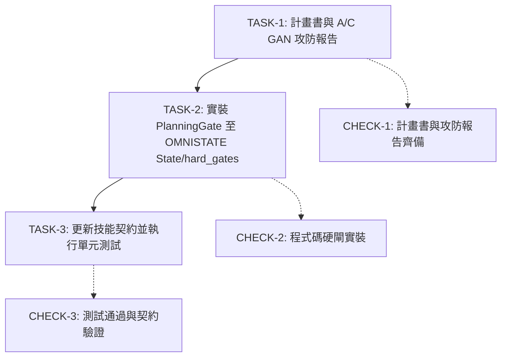

# 計畫書：OMNISTATE 需求前置規劃、工作圖譜與獨立審查治理引擎整合計畫
**PLAN_OMNISTATE_PLANNING_SUBTASK_GOVERNANCE_20261031**

- **建立日期**: 2026-10-31
- **任務編號**: `WBS-OMNISTATE-PLANNING-GATE`
- **風險級別**: `Standard`（涉及狀態機核心、Hard Gate、CLI、技能契約與測試）
- **關聯提案**: `C:\dev\omnistate\docs\omnistate-requirement-and-subtask-plan.md`
- **狀態**: `APPROVED`
- **範圍目錄 (`scope_paths`)**:
  - `OMNISTATE State/`
  - `docs/`
  - `tests/`
  - `.agents/skills/omnistate/`

---

## 1. 背景與核心動機

在傳統 AI 輔助開發中，模型常面臨「未審先寫、邊寫邊猜、做表面工夫」的宿疾。
先前在獨立 repo `C:\dev\omnistate` 的 `proposal/omnistate-planning-subtasks` 分支中，已研發出全新的一等公民確定性硬閘——**PlanningGate**：
1. **Memo 保真**：強制記錄原始 Prompt 與參考依據，未紀錄直接拒絕 Audit。
2. **Checklist 綁定 Subtasks**：每個驗收項目必須具備相依的實作或驗證任務，依賴未完成不可提早標記 PASS。
3. **Plan-Review 獨立子代理審查**：在動手修改代碼前，強制由獨立審查子代理評估對齊度與潛在衝突，狀態必須為 `APPROVED` 或 `RESOLVED`。

本計畫旨在將此套機制完整引進並常駐於 `Project` 專案中，使 `Project` 的 `OMNISTATE State` 治理體系正式具備先企劃後實作的剛性防線。

---

## 2. 實裝目標與交付項目 (Deliverables)

1. **Hard Gate 整合**：
   - 建立 `OMNISTATE State/hard_gates/planning_gate.py`，完整支援 `memo`、`checklist`、`subtasks`、`plan_review` 檢查。
   - 整合入 `omnistate warden` 與 `omnistate` 評估清單。
2. **代理人技能更新**：
   - 建立/更新 `.agents/skills/omnistate/SKILL.md`，將 10 步生命週期（begin -> memo -> checklist -> subtask -> plan-review -> implement -> verify -> audit -> finish）固化為標準操作守則。
3. **驗證測試**：
   - 在 `OMNISTATE State/tests/` 建立 `test_planning_gate_integration.py`，確保依賴衝突、漏審、自打分等情況 100% 攔截。

---

## 3. 執行依賴與工作圖譜 (DAG)

---

## 4. 驗收門檻 (Acceptance Criteria)

- [x] CHECK-1: 建立標準計畫書與 A/C GAN 報告，無未決爭議。
- [x] CHECK-2: `PlanningGate` 成功攔截未審核與未關聯任務，並放行完整證據鏈。
- [x] CHECK-3: `python -m unittest` 與 `audit_skills_contract.py` 均通過。
